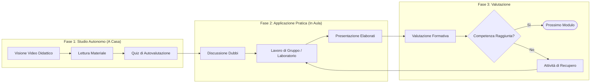
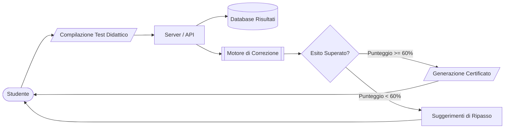

# Esempi Pratici di Flowchart in Mermaid JS

Questa raccolta fornisce modelli pronti all'uso per diverse tipologie di diagrammi di flusso.

---

## Esempio 1: Diagramma Didattico Decisionale (Analisi Logica - Il Soggetto)

Questo diagramma illustra un algoritmo guidato per individuare il soggetto in una frase:

```mermaid
flowchart TD
    classDef startEnd fill:#d4edda,stroke:#28a745,stroke-width:2px,color:#155724;
    classDef decision fill:#fff3cd,stroke:#ffc107,stroke-width:2px,color:#856404;
    classDef action fill:#d1ecf1,stroke:#17a2b8,stroke-width:2px,color:#0c5460;
    classDef result fill:#f8d7da,stroke:#dc3545,stroke-width:2px,color:#721c24;

    Start([Inizio Analisi]) :::startEnd
    FindVerb["1. Trova il Predicato (Verbo)"] :::action
    CheckVerb{Il verbo è alla<br/>forma personale?} :::decision
    AskWho["2. Chiediti:<br/>'Chi compie o subisce l'azione?'"] :::action
    IsExplicit{Il soggetto è<br/>espresso nella frase?} :::decision
    SoggEspresso["Soggetto Espresso<br/>(es. 'Marco corre')"] :::result
    SoggSottinteso["Soggetto Sottinteso<br/>(es. '(Io) ho mangiato')"] :::result
    ModoImpersonale["Verbo Impersonale<br/>(Nessun soggetto, es. 'Piove')"] :::result

    Start --> FindVerb
    FindVerb --> CheckVerb
    CheckVerb -->|Sì| AskWho
    CheckVerb -->|No| ModoImpersonale
    AskWho --> IsExplicit
    IsExplicit -->|Sì| SoggEspresso
    IsExplicit -->|No| SoggSottinteso
```

---

## Esempio 2: Architettura a Fasi con Subgraph (Ciclo di Apprendimento)

Rappresentazione di un ciclo didattico basato sulla metodologia flipped classroom / inquiry:



---

## Esempio 3: Workflow Sequenziale Orizzontale con Icone e Database


