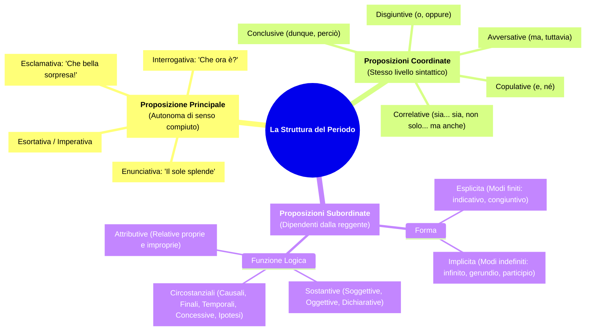
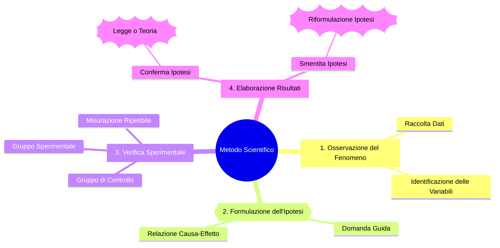
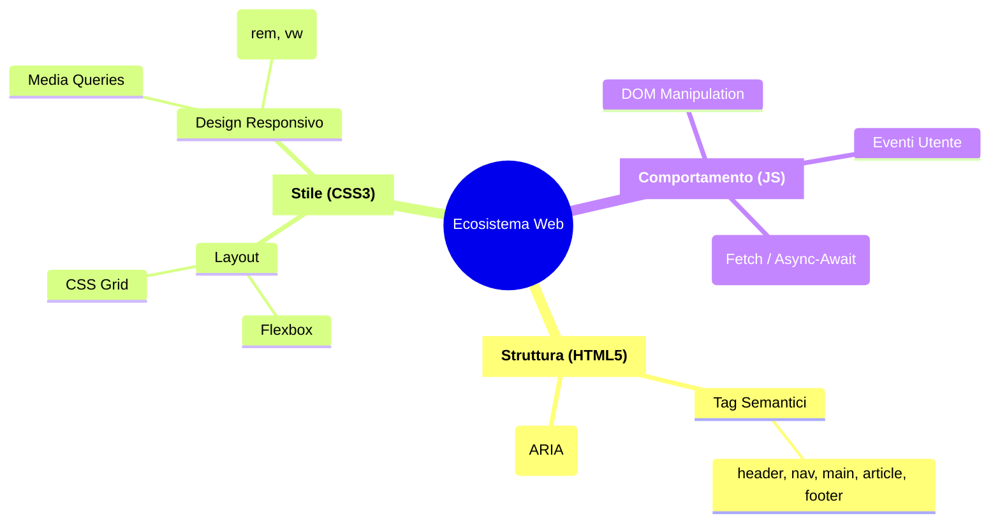

# Esempi Pratici di Mappe Concettuali (Mindmap) in Mermaid JS

Questa raccolta fornisce modelli di mappe concettuali e mentali didattiche e tassonomiche.

---

## Esempio 1: Mappa Didattica di Grammatica (La Struttura del Periodo)

Questo esempio dimostra come schematizzare le relazioni tra proposizioni nella grammatica italiana:

---

## Esempio 2: Mappa Concettuale Scientifica (Il Metodo Scientifico Sperimentale)

Questo esempio sfrutta diverse forme per distinguere i momenti dell'indagine scientifica:

---

## Esempio 3: Architettura Concettuale (I Pilastri del Web Moderno)

