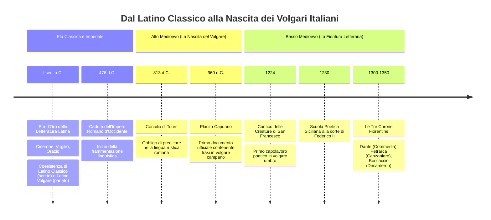
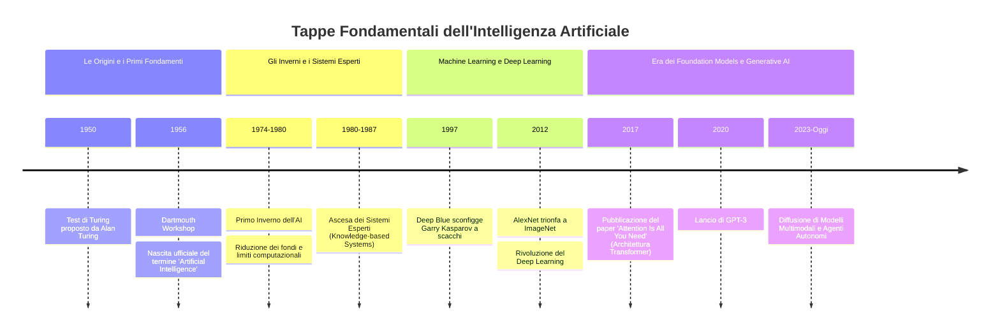
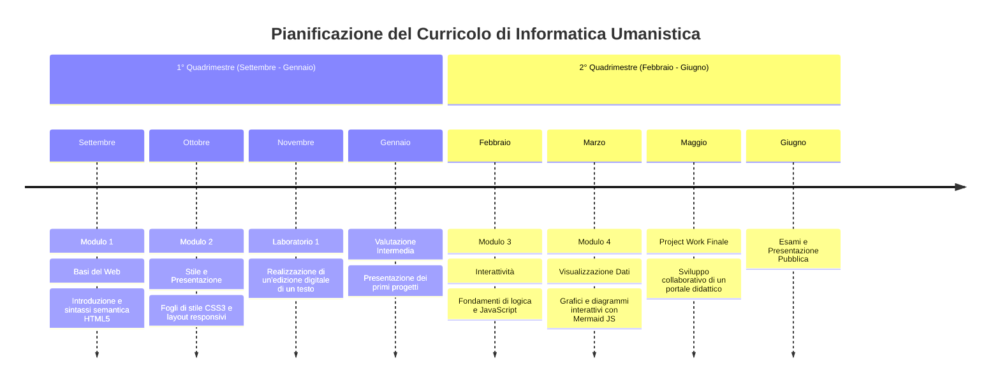

# Esempi Pratici di Timeline in Mermaid JS

Questa raccolta fornisce modelli di linee temporali per la didattica, la storia, l'evoluzione tecnologica e la pianificazione.

---

## Esempio 1: Cronologia Storico-Linguistica (Dal Latino all'Italiano)

Un esempio didattico che mostra l'evoluzione della lingua latina verso i volgari:

---

## Esempio 2: Storia dell'Intelligenza Artificiale

---

## Esempio 3: Roadmap Didattica Annuale (Curricolo Scolastico)

