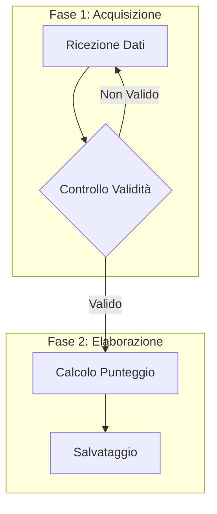
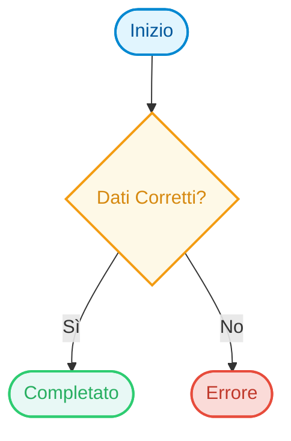
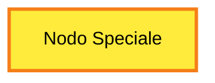

# Guida Completa ai Flowchart in Mermaid JS

I diagrammi di flusso (**Flowcharts**) sono ideali per rappresentare processi sequenziali, algoritmi, alberi decisionali e flussi di lavoro passo-passo.

Documentazione ufficiale: [Mermaid Flowcharts](https://mermaid.js.org/syntax/flowchart.html)

---

## 1. Direzione del Flusso (Orientamento)

La dichiarazione iniziale definisce l'orientamento del diagramma:

| Dichiarazione | Orientamento | Ideale per |
| :--- | :--- | :--- |
| `flowchart TD` oppure `flowchart TB` | Dall'alto verso il basso (Top to Down / Bottom) | Processi verticali standard, alberi decisionali, gerarchie didattiche |
| `flowchart LR` | Da sinistra a destra (Left to Right) | Pipeline temporali, flussi di dati, passaggi sequenziali lunghi |
| `flowchart BT` | Dal basso verso l'alto (Bottom to Top) | Risalita genealogica, bottom-up design |
| `flowchart RL` | Da destra a sinistra (Right to Left) | Flussi specifici RTL |

> **Nota:** Preferire sempre `flowchart` rispetto al deprecato `graph`.

---

## 2. Forme dei Nodi (Node Shapes)

La sintassi delle parentesi determina la forma visiva e il significato semantico del nodo:

| Sintassi | Forma | Uso semantico consigliato |
| :--- | :--- | :--- |
| `id["Testo"]` | Rettangolo standard | Azione, operazione, passaggio standard |
| `id("Testo")` | Rettangolo con angoli arrotondati | Azione iniziale, messaggio neutro |
| `id(["Testo"])` | Stadio / Pillola (Stadium) | Inizio / Fine processo (Terminatori) |
| `id[["Testo"]]` | Subroutine (bordo doppio) | Sotto-processo o funzione richiamata esternamente |
| `id[("Testo")]` | Cilindro | Database, archivio o risorsa persistente |
| `id(("Testo"))` | Cerchio | Punto di raccordo, connettore di pagina |
| `id((("Testo")))` | Doppio cerchio | Stato finale o obiettivo raggiunto |
| `id>"Testo"]` | Forma asimmetrica (Bandierina) | Evento, notifica, output visivo |
| `id{"Testo"}` | Rombo (Decisione) | Condizione logica, bivio (Sì / No) |
| `id{{"Testo"}}` | Esagono | Preparazione, verifica preliminare o iterazione |
| `id[/"Testo"/]` | Parallelogramma | Input / Output dati |
| `id[/"Testo"\]` | Trapezio | Operazione manuale o input utente |
| `id[\"Testo"/]` | Trapezio invertito | Riduzione o sintesi dati |

---

## 3. Tipi di Collegamenti ed Etichette (Edges & Links)

I connettori definiscono la relazione e il passaggio tra i nodi:

### Collegamenti con Frecce
- Freccia semplice: `A --> B`
- Freccia con etichetta testuale (due sintassi ammesse):
  - `A -->|Testo| B` (consigliata e più pulita)
  - `A -- Testo --> B`

### Altri Tipi di Linee
- Linea continua senza freccia: `A --- B`
- Linea tratteggiata con freccia: `A -.-> B`
- Linea tratteggiata con testo: `A -. Testo .-> B`
- Linea spessa (bold): `A ==> B`
- Linea spessa con testo: `A == Testo ==> B`
- Freccia bidirezionale: `A <--> B`
- Collegamento invisibile (per forzare l'allineamento/layout): `A ~~~ B`

### Lunghezza dei Connettori (Controllo del Layout)
È possibile allungare i connettori aggiungendo trattini extra per posizionare i nodi più lontani:
- `A ---> B` (lunghezza 2)
- `A ----> B` (lunghezza 3)

---

## 4. Subgraphs (Raggruppamenti e Contesti)

I `subgraph` permettono di isolare sezioni logiche, moduli o contesti:

Regole per i Subgraph:
1. Assegnare sempre un identificatore univoco senza spazi (`subgraph InputPhase`) e un'etichetta racchiusa tra virgolette (`["Titolo"]`).
2. Chiudere sempre ogni blocco con `end`.
3. È possibile collegare direttamente un nodo dentro un subgraph con un nodo esterno.

---

## 5. Styling e Classi Visive

### Definizione di classi riutilizzabili (`classDef`):

### Stile inline per singolo nodo:

---

## 6. Regole di Sicurezza e Best Practice (Evitare Errori di Rendering)

1. **Usa SEMPRE virgolette per i testi dei nodi:**
   - ❌ Errato: `A{Verifica (tipo A/B)}` -> *Errore di sintassi per via delle parentesi*
   -  Corretto: `A{"Verifica (tipo A/B)"}`

2. **Evita parole riservate come ID dei nodi:**
   - Parole da NON usare come ID: `end`, `subgraph`, `graph`, `flowchart`, `style`, `class`, `default`.
   - Preferisci ID descrittivi: `step_start`, `check_input`, `node_1`.

3. **Interruzioni di riga:**
   - Usa ` ` o ` ` per andare a capo nel testo del nodo:
   - `A["Prima riga Seconda riga informativa"]`

4. **Caratteri speciali ed entità HTML:**
   - Usa `&quot;` per le virgolette interne al testo.
   - Per apici e doppi apici: `A["Nome dell'&quot;Autore&quot;"]`
