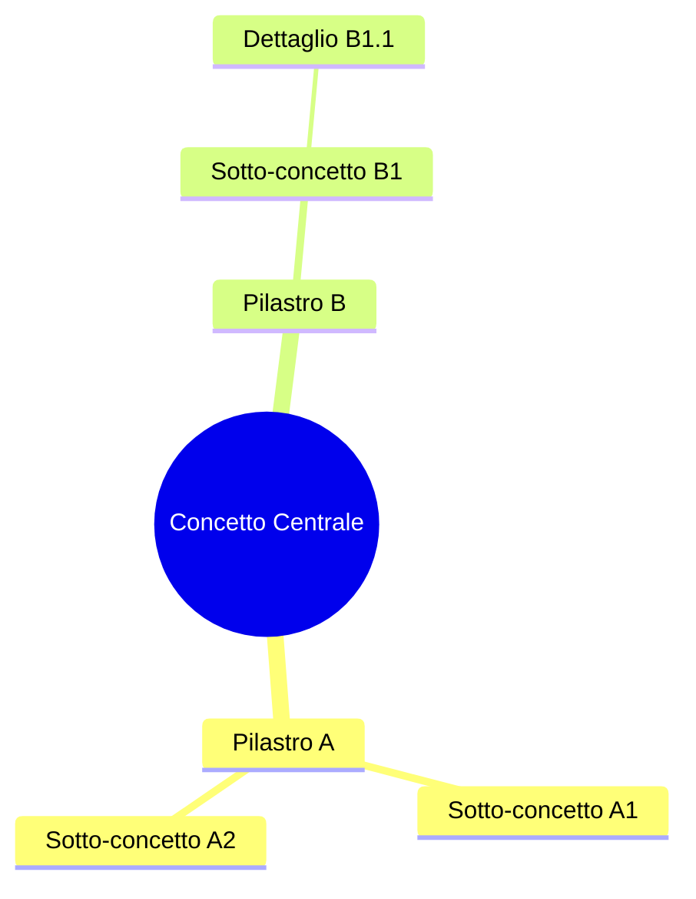
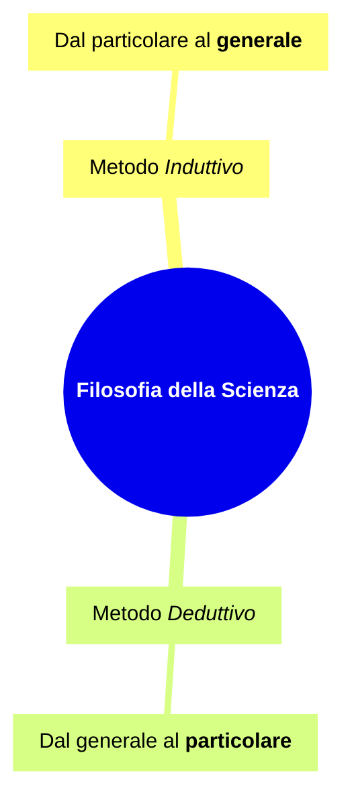
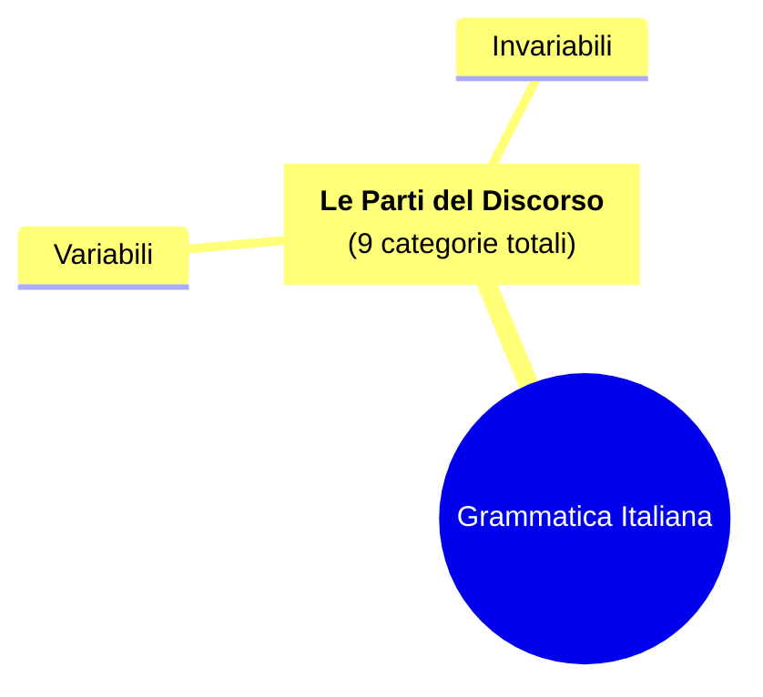

# Guida Completa alle Mappe Concettuali (Mindmap) in Mermaid JS

Le **Mappe Concettuali e Mentali** (`mindmap`) sono ideali per organizzare idee, schematizzare argomenti didattici, rappresentare tassonomie, relazioni gerarchiche e alberi tematici partendo da un concetto centrale.

Documentazione ufficiale: [Mermaid Mindmap](https://mermaid.js.org/syntax/mindmap.html)

---

## 1. Struttura Fondamentale e Regola dell'Indentazione

La sintassi delle mappe concettuali si basa rigorosamente sull'**indentazione**. Non si utilizzano frecce (`-->`), ma la relazione tra concetti è definita unicamente dal livello di rientro.



### Regole auree dell'indentazione:
1. **Usa 2 o 4 spazi costanti:** Non mescolare tabulazioni (`\t`) e spazi.
2. **Un solo nodo Radice (Root):** Il primo elemento subito sotto `mindmap` deve essere unico.
3. **Gerarchia progressiva:** Non saltare livelli di indentazione (ad esempio da livello 1 a livello 3 senza passare per il 2).

---

## 2. Forme dei Nodi nelle Mappe Concettuali

In Mermaid Mindmap, le forme si definiscono circondando il testo con specifici delimitatori:

| Sintassi | Forma | Uso consigliato nella mappa |
| :--- | :--- | :--- |
| `Nome del concetto` | Senza bordo (Default) | Foglie terminali, dettagli, esempi |
| `[Concetto in Rettangolo]` | Rettangolo classico | Categorie, definizioni, regole |
| `(Concetto Arrotondato)` | Rettangolo arrotondato | Argomenti secondari, moduli |
| `((Nodo Centrale o Circolare))` | Cerchio | Nodo radice (Core concept), concetti cardine |
| `))Forma Esplosa o Nuvola((` | Bang / Nuvola (Cloud) | Idee creative, eccezioni, punti salienti |
| `{{Concetto Esagonale}}` | Esagono | Domande chiave, verifiche, principi |

---

## 3. Formattazione Avanzata del Testo e Markdown

Mermaid Mindmap supporta la formattazione Markdown all'interno dei nodi racchiudendo il contenuto tra `["` e `"]`:



### Testo su Più Righe:
Per andare a capo all'interno di un nodo, racchiudere il testo tra virgolette e usare il tag `<br/>`:


---

## 4. Classi di Stile e Icone

È possibile associare classi di stile ai nodi utilizzando l'operatore `:::nomeClasse`:

```mermaid
mindmap
  root((Progetto Digitale))
    Frontend:::frontendClass
      React
      CSS Moderno
    Backend:::backendClass
      NodeJS
      Database SQL

  classDef frontendClass fill:#e3f2fd,stroke:#1976d2,stroke-width:2px;
  classDef backendClass fill:#fbe9e7,stroke:#d84315,stroke-width:2px;
```

---

## 5. Errori Comuni e Trappole di Sintassi (Da Evitare Assolutamente)

1. **NON usare MAI le frecce (`-->`) in una mindmap:**
   - ❌ Errato:
     ```
     mindmap
       root --> Figlio
     ```
   -  Corretto:
     ```
     mindmap
       root
         Figlio
     ```

2. **Non inserire più nodi radice:**
   - ❌ Errato:
     ```
     mindmap
       Radice 1
         Figlio A
       Radice 2
         Figlio B
     ```
   -  Corretto: Creare un unico super-concetto contenitore, oppure due diagrammi distinti.

3. **Caratteri speciali nel testo:**
   - Se il nome di un concetto contiene virgole, due punti, trattini, parentesi tonde o caratteri matematici, racchiudilo sempre tra virgolette:
   -  `["Esempio: Analisi del testo (livello 1)"]`

4. **Nessun nodo vuoto:**
   - Evita righe vuote o righe composte solo da spazi all'interno della struttura della mindmap.
