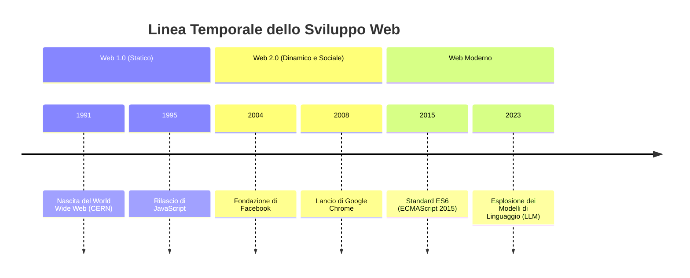
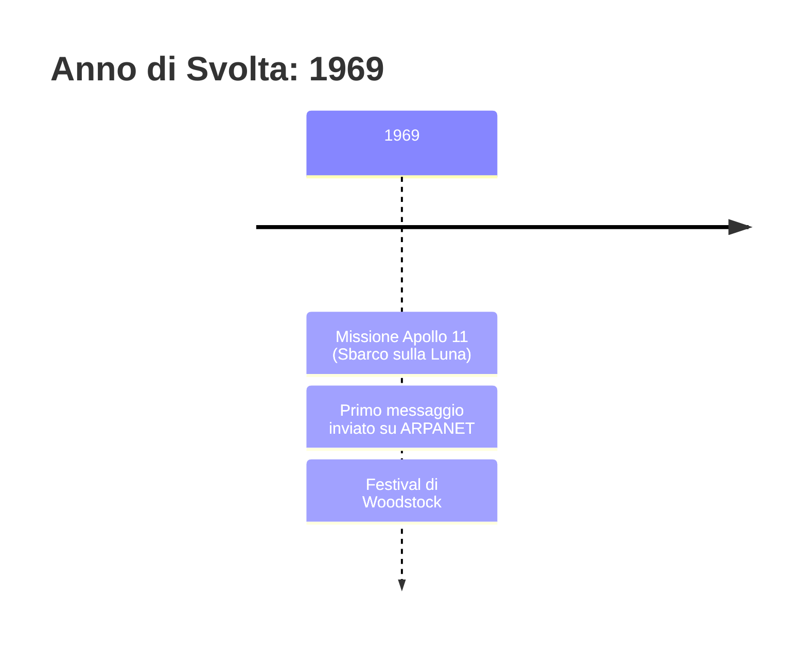
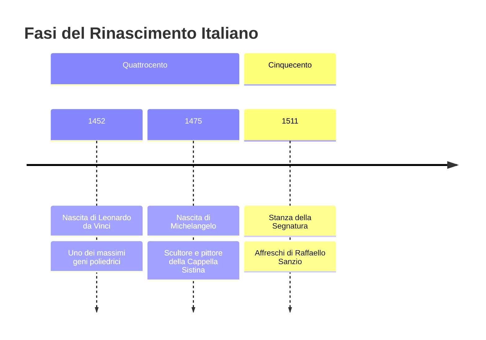

# Guida Completa alle Timeline (Linee Temporali) in Mermaid JS

Le **Timeline** (`timeline`) sono il tipo di diagramma ideale per rappresentare sequenze cronologiche, epoche storiche, evoluzione di idee o teorie, roadmap di progetti e cicli di vita temporali.

Documentazione ufficiale: [Mermaid Timeline](https://mermaid.js.org/syntax/timeline.html)

---

## 1. Struttura Fondamentale

La timeline si compone di tre elementi gerarchici:
1. **Dichiarazione iniziale e Titolo:** `timeline` seguito da `title Titolo del diagramma`.
2. **Sezioni tematiche o epoche (opzionali ma consigliate):** `section Nome della Sezione`.
3. **Periodi temporali ed Eventi:** `Periodo : Evento 1`.

---

## 2. Eventi Multipli nello Stesso Periodo

Spesso in una data o in un anno si verificano più eventi degni di nota. In Mermaid, si possono elencare più eventi per lo stesso periodo andando a capo e inserendo `:` allineato:

---

## 3. Eventi con Dettaglio o Descrizione

È possibile associare una descrizione secondaria a un evento aggiungendo un ulteriore `:`:

---

## 4. Tipologie di Periodi Ammessi

I periodi temporali possono essere formattati in diversi modi in base al contesto:

| Tipologia | Esempio sintassi | Ideale per |
| :--- | :--- | :--- |
| **Anni o Secoli** | `1300`, `V secolo a.C.`, `2024` | Storia, letteratura, filosofia |
| **Mesi e Giorni** | `15 Marzo 44 a.C.`, `Gennaio 2024` | Cronaca, eventi dettagliati |
| **Fasi o Milestone** | `Fase 1 (Pianificazione)`, `Sprint 3` | Project management, didattica a progetti |
| **Trimestri / Quarti** | `2024 Q1`, `Q2 2025` | Roadmap aziendali e rilascio software |

---

## 5. Regole di Sicurezza e Best Practice

1. **Gestione del carattere due punti (`:`):**
   - Poiché il simbolo `:` è il separatore sintattico tra Periodo ed Evento, **non inserire due punti non necessari all'interno del testo dell'evento**, oppure formula la frase per evitarli.
   - ❌ Rischioso: `2024 : Fase: Test finali` -> *Può interpretare "Test finali" come descrizione aggiuntiva indesiderata*
   -  Consigliato: `2024 : Fase dei Test Finali`

2. **Ordine cronologico naturale:**
   - Mermaid disegna gli elementi nell'ordine in cui sono dichiarati nel codice. Ordina sempre i periodi in modo strettamente sequenziale (dal più antico al più recente, o secondo l'iter previsto).

3. **Etichette concise:**
   - La timeline organizza il testo in box temporali visivi. Testi eccessivamente prolissi rischiano di saturare la larghezza orizzontale. Prediligi titoli chiari ed evidenzia i dettagli chiave.

4. **Uso delle sezioni (`section`):**
   - Raggruppare i periodi in sezioni conferisce una colorazione alternata e visivamente distinta tra le epoche, aumentando drasticamente la leggibilità.
